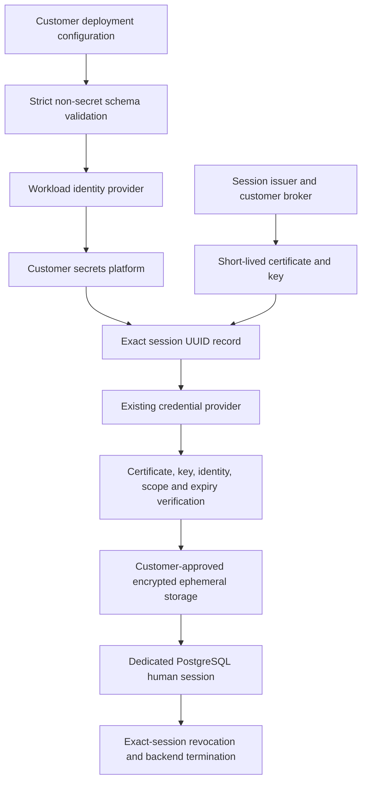

# Gate 0.5.14.8.3 — Provider-Neutral Configuration Validation and Adapter Design

- Status: Design and configuration-validation implementation; CI and review pending
- Branch: `security/revenue-assurance-gate-0.1`
- Scope: non-secret customer deployment metadata for the human-session credential adapter
- Out of scope: live Vault/other provider client, customer endpoint access, workload authentication, CA issuance, secret writes, production certification

## 1. Decision boundary

The application continues to depend on the existing `HumanSessionCredentialStore` protocol. Provider-specific SDKs and request/response types must remain inside an adapter package and must not leak into issuance, authorization, or database-session code.

`provider_id` is a customer deployment selection, not a hard-coded vendor enum. The customer may select an already-approved secrets platform or approve a new one. The HashiCorp Vault ADR is a reference design only; it does not establish customer approval.

## 2. Configuration contract

The new `HumanSessionProviderConfig` validates only non-secret metadata:

| Field | Requirement |
|---|---|
| `provider_id` | Stable lowercase adapter identifier; no default vendor |
| `endpoint` | Absolute HTTPS URL; no embedded username/password, query, or fragment |
| `ca_bundle_path` | Absolute customer-managed trust bundle path; existence and ownership checked at deployment |
| `namespace` | Explicit customer/environment namespace reference |
| `secret_store` | Explicit secret mount/store reference |
| `credential_path_prefix` | Restricted path prefix; no traversal or wildcards |
| `certificate_issuer_ref` | Explicit issuing-CA reference |
| `certificate_role_ref` | Explicit certificate role/profile reference |
| `workload_identity_method` | Named workload identity mechanism, not a static token |
| `workload_identity_audience` | Explicit audience bound to the workload identity |
| `request_timeout_seconds` | Bounded network timeout |

Unknown keys are rejected. In particular, access tokens, root/operator tokens, passwords, private keys, client secrets and DSNs are not valid fields. Configuration validation does not authenticate, prove authorization, verify CA file contents, or contact the provider.

The safe wrapper raises a generic `ProviderConfigurationError` without echoing untrusted values. Callers must not log raw input mappings or detailed Pydantic validation errors.

## 3. Trust boundaries and runtime sequence

Required sequence for a future concrete adapter:

1. Validate immutable startup configuration before serving session issuance.
2. Obtain short-lived workload identity from the hosting platform; never accept a static root/operator token from application config.
3. Authenticate to the provider using the configured audience and customer-approved auth method.
4. Authorize only the exact session path operations required by the adapter. No wildcard list/read, policy administration, mount administration, CA administration or audit administration.
5. Store the complete credential record atomically under the exact session UUID. Identical retry is idempotent; changed content conflicts.
6. Retrieve by exact UUID only; validate all actor/scope/role/entitlement/certificate/key/expiry properties before opening PostgreSQL.
7. On revocation, prevent future retrieval and terminate existing PostgreSQL backends for the exact session according to the customer-approved policy.
8. Emit non-secret audit events for issuance, retrieval, renewal and revocation. Never emit PEM, private keys, bearer tokens, DSNs or secret payloads.

## 4. Provider permission matrix

| Operation | Application workload | PKI/security administrator |
|---|---:|---:|
| Create exact session record | Allow | Optional break-glass |
| Read exact session record | Allow | Audited |
| Revoke exact session record | Allow, if approved | Allow |
| List other sessions / wildcard read | Deny | Separately governed |
| Change policies, namespaces or mounts | Deny | Allow |
| Read CA private key / issue arbitrary cert | Deny | Deny by default; separate CA workflow |
| Configure audit devices / retention | Deny | Allow |
| Read or use root/operator token | Deny | Break-glass only, never application runtime |

Provider-specific policy syntax must be authored and independently reviewed only after the customer confirms its provider, edition, namespace/mount model and workload identity method.

## 5. Lifecycle and failure handling

- **Create:** immutable exact-session UUID; complete record is atomic.
- **Retry:** identical complete record is idempotent; any mutation is a conflict.
- **Read:** exact UUID only; missing, expired, revoked or unauthorized returns no credential.
- **Renew:** issue a new short-lived certificate/session, validate it, prove the replacement connection, then revoke the old lease according to customer policy.
- **Revoke:** mark exact lease unusable, block new sessions, terminate existing database backends as required, and retain a non-secret audit record.
- **Outage/timeout/invalid response:** fail closed; no shared credential, fallback session, environment secret, or stale credential is substituted.
- **Audit outage:** follow a customer-approved fail-closed or explicitly risk-accepted emergency policy; do not silently suppress required security audit events.

Private keys must remain encrypted under customer-controlled key management at rest and must only be materialized into customer-approved encrypted ephemeral storage for the connection lifetime. The existing mode-0700/mode-0600 file protections do not prove the underlying filesystem is encrypted.

## 6. Acceptance criteria

1. Unit tests cover valid config, HTTPS-only endpoint, endpoint credential/query rejection, absolute CA path, safe namespace/mount/path references, issuer/role references, workload identity method/audience, timeout bounds and unknown-field rejection.
2. Secret-bearing fields are rejected and safe validation errors do not echo submitted values.
3. Startup refuses invalid or incomplete production configuration before the adapter is constructed.
4. Provider adapter tests prove workload identity expiry, least privilege, denied permissions, exact UUID atomicity, idempotency, conflict, tenant/BU isolation, expiry, revocation, provider outage, timeout and malformed responses.
5. Provider audit evidence covers issuance, retrieval, renewal and revocation without sensitive payloads.
6. Private-key storage, encrypted ephemeral materialization and cleanup are verified in the customer environment.
7. PostgreSQL tests prove exact-session mapping, backend termination on revocation and fail-closed behavior.
8. All existing Python quality/tests and PostgreSQL 14–17 security/integration gates remain green.
9. Independent security reviewer and customer security owner approve the concrete adapter before production use.

## 7. Customer decisions required before concrete adapter work

- Approved provider and deployment/edition.
- Endpoint and CA trust bundle ownership.
- Namespace and secret mount/store.
- Credential path convention.
- Workload identity mechanism and audience.
- PKI issuer and role/profile.
- Least-privilege policy owner and review process.
- Audit destination, retention and outage policy.
- Encrypted ephemeral storage implementation.
- Certificate lifetime, renewal window and revocation SLA.
- PostgreSQL backend termination procedure and operational owner.
- Non-production test endpoint and customer acceptance owner.

## 8. Explicit non-claims

This gate does not implement or validate a production Vault SDK, AWS/Azure adapter, workload identity exchange, IAM policy, certificate authority, broker, audit device, encrypted storage, customer PostgreSQL TLS handshake or live revocation. No provider has been selected on the customer's behalf. No production readiness or certification is implied.
